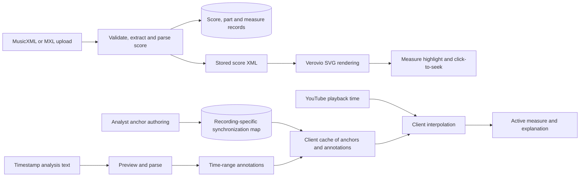
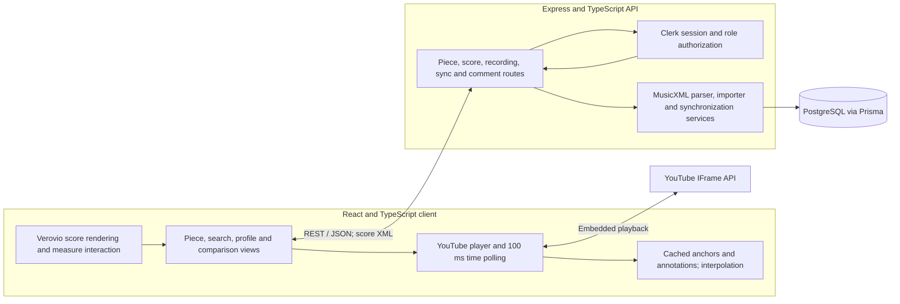
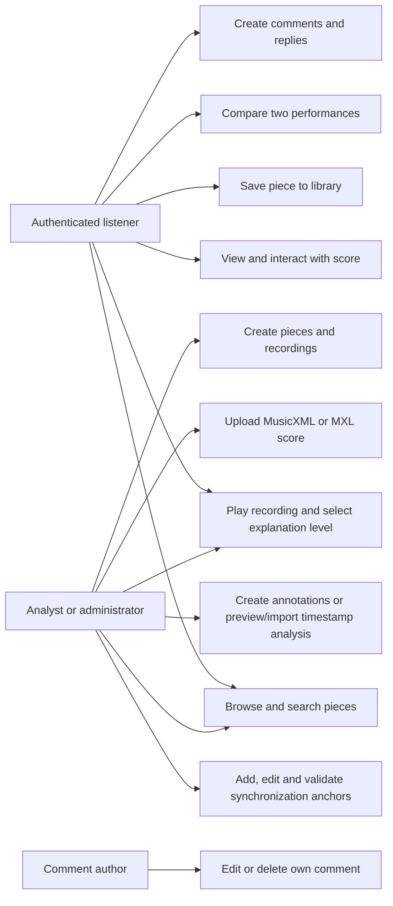
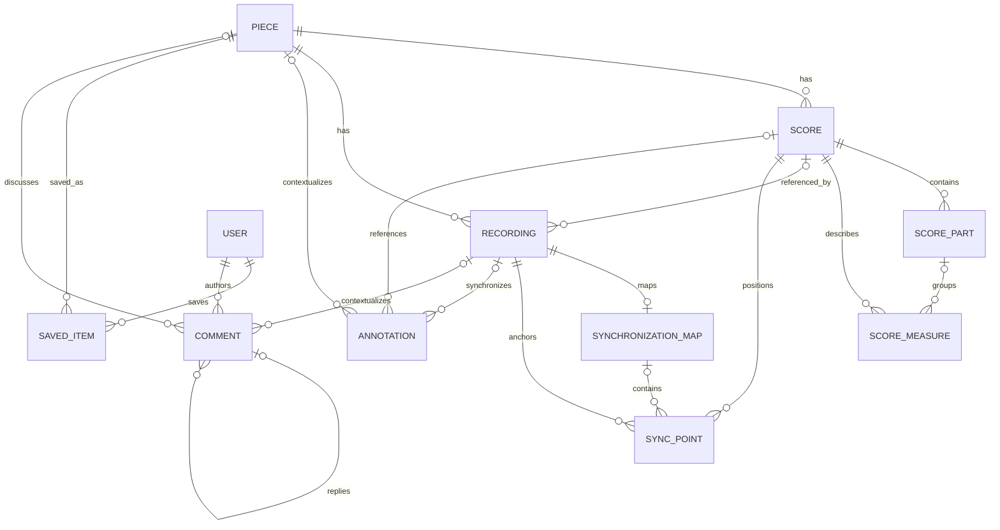
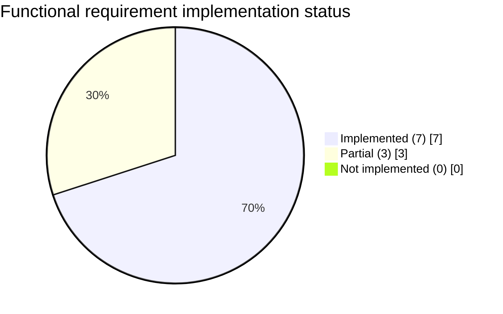
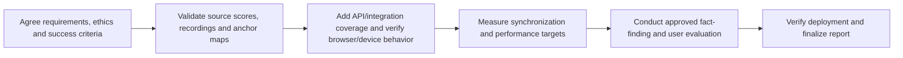

<div align="center">

**DEDAN KIMATHI UNIVERSITY OF TECHNOLOGY**

**SCHOOL OF COMPUTER SCIENCE AND INFORMATION TECHNOLOGY**

DEPARTMENT OF COMPUTER SCIENCE

# NOTA

**A TIMESTAMP-DRIVEN MULTIMEDIA SYNCHRONIZATION PLATFORM FOR INTERACTIVE CLASSICAL MUSIC EDUCATION AND APPRECIATION**

**BY**

**KIMANI ISAAC GEITA** — CO26-01-0704/2023

**MWANGI WASHINGTON MACHARIA** — C026-01-0705/2023

**WANJIRU JULIAN WAMBUI** — C026-01-0669/2023

*A project progress documentation submitted to the Department of Computer Science in partial fulfillment of the requirements for the award of the degree of Bachelor of Science in Computer Science of Dedan Kimathi University of Technology*

**2026**

</div>

---

## Table of Contents

- [Declaration](#declaration)
- [Abstract](#abstract)
- [List of Tables](#list-of-tables)
- [List of Figures](#list-of-figures)
- [Definition of Terms](#definition-of-terms)
- [Chapter One: Introduction](#chapter-one-introduction)
  - [1.1 Background](#11-background)
  - [1.2 Statement of the Problem](#12-statement-of-the-problem)
  - [1.3 Objectives](#13-objectives)
  - [1.4 Research Questions](#14-research-questions)
  - [1.5 Justification](#15-justification)
  - [1.6 Scope](#16-scope)
  - [1.7 Limitation](#17-limitation)
- [Chapter Two: Literature Review](#chapter-two-literature-review)
  - [2.1 Introduction](#21-introduction)
  - [2.2 Case Studies](#22-case-studies)
  - [2.3 Summary](#23-summary)
  - [2.4 Research Gap](#24-research-gap)
  - [2.5 Proposed Methodology](#25-proposed-methodology)
- [Chapter Three: Methodology](#chapter-three-methodology)
  - [3.1 Introduction](#31-introduction)
  - [3.2 Fact-Finding Techniques](#32-fact-finding-techniques)
  - [3.3 Software Design](#33-software-design)
  - [3.4 Preliminary Data Processing and Analysis](#34-preliminary-data-processing-and-analysis)
- [Chapter Four: System Design and Implementation](#chapter-four-system-design-and-implementation)
  - [4.1 Introduction](#41-introduction)
  - [4.2 Design Goals and Constraints](#42-design-goals-and-constraints)
  - [4.3 System Architecture](#43-system-architecture)
  - [4.4 Use Case Model](#44-use-case-model)
  - [4.5 Data Model](#45-data-model)
  - [4.6 Synchronization Design](#46-synchronization-design)
  - [4.7 Application Programming Interface](#47-application-programming-interface)
  - [4.8 Implementation Snapshots](#48-implementation-snapshots)
  - [4.9 Security, Privacy and Ethical Considerations](#49-security-privacy-and-ethical-considerations)
- [Chapter Five: Conclusions and Recommendations](#chapter-five-conclusions-and-recommendations)
  - [5.1 Introduction](#51-introduction)
  - [5.2 Implementation Status Against the Proposal](#52-implementation-status-against-the-proposal)
  - [5.3 Verification Results](#53-verification-results)
  - [5.4 Planned Evaluation](#54-planned-evaluation)
  - [5.5 Discussion](#55-discussion)
  - [5.6 Challenges, Risks and Mitigations](#56-challenges-risks-and-mitigations)
  - [5.7 Remaining Work Plan](#57-remaining-work-plan)
  - [5.8 Conclusions](#58-conclusions)
  - [5.9 Recommendations](#59-recommendations)
- [References](#references)
- [Appendices](#appendices)

---

## Declaration

**Candidates' Declaration**

This documentation is our original work and has not been presented for a degree in any other University.

| Name | Signature | Date |
| --- | --- | --- |
| **Geita Isaac Kimani** | …………………….… | ……………………….. |
| **Mwangi Washington Macharia** | …………………….… | ……………………….. |
| **Wanjiru Julian Wambui** | …………………….… | ……………………….. |

**Supervisor's Declaration**

This progress documentation has been submitted for examination with my approval as University Supervisor.

| Name | Signature | Date |
| --- | --- | --- |
| Dr. George Musumba | …………………….… | ……………………….. |

---

## Abstract

Classical music appreciation can be difficult for learners who must coordinate recordings, scores and commentary across separate resources. This project develops Nota, a web-based platform that links performance playback to score measures and explanatory annotations for two learner-selected levels. The study aims to investigate listener challenges, design a human-authored synchronization mechanism, implement a prototype and evaluate usability and educational effectiveness. The current prototype includes piece discovery and search, saved pieces, YouTube playback, MusicXML/MXL ingestion and rendering, an anchor-authoring interface, piecewise-linear score-position interpolation, timestamped explanations, comments and side-by-side performance comparison.

The client is implemented in React and TypeScript with Vite; the API uses Node.js, Express and TypeScript; and relational data are managed with Prisma and PostgreSQL. Clerk provides authentication, while analyst and administrator roles protect authoring operations. The client caches synchronization anchors and annotations and interpolates score position locally as the YouTube player is polled every 100 milliseconds. A server-side interpolation and annotation endpoint is also available. Verification completed for this report includes 26 synchronization-engine tests, timestamp-importer checks, a server TypeScript build and a client production build. These checks establish implementation evidence but do not establish measured synchronization accuracy, cross-browser performance, usability or educational effect. Participant evaluation and deployment verification remain outstanding; accordingly, the contribution is a functioning prototype and documented design, not demonstrated learning effectiveness.

---

## List of Tables

| Table | Title |
| --- | --- |
| Table 1 | Comparison of the Proposed Platform with Existing Music Learning Systems |
| Table 2 | Functional Requirements |
| Table 3 | Non-Functional Requirements |
| Table 4 | Sprint Plan and Status at the Progress Stage |
| Table 5 | Testing Targets and Verification Methods |
| Table 6 | Architecture Layers and Responsibilities |
| Table 7 | Implemented Application Programming Interface Operations |
| Table 8 | Status of Functional Requirements |
| Table 9 | Status of Non-Functional Requirements |
| Table 10 | Evidence of Progress by Sprint |
| Table 11 | Progress Against the Specific Objectives |
| Table 12 | Boundary-Case Desk-Check of Measure-Position Interpolation |
| Table 13 | Evaluation Plan |
| Table 14 | Risks and Mitigations |
| Table 15 | Hardware Requirements |
| Table 16 | Software Requirements |
| Table 17 | Remaining Milestones, Deliverables and Evidence of Completion |
| Table 18 | Project Budget |
| Table 19 | Compliance Matrix Against the University Proposal Guide |

## List of Figures

| Figure | Title |
| --- | --- |
| Figure 1 | Preliminary Data-Processing and Synchronization Pipeline |
| Figure 2 | Component View of the Current Nota Prototype |
| Figure 3 | Use Case Diagram of the Nota Prototype |
| Figure 4 | Domain Class Diagram Derived from the Prisma Schema |
| Figure 5 | Sequence Diagram of the Playback-to-Explanation Lookup |
| Figure 6 | Step Lookup Versus Piecewise Linear Interpolation for Three Anchor Points |
| Figure 7 | Status of the Ten Functional Requirements at the Progress Stage |
| Figure 8 | Proposed Sequence of Remaining Project Milestones |

---

## Definition of Terms

**Active measure:** The integer measure selected from the interpolated score position at the current playback time.

**Annotation:** An explanatory text attached to a range of measures for a recording and a learning track.

**Anchor point (sync point):** A pairing of a score measure number with a timestamp in a specific recording, authored by a music analyst.

**Classical music:** A tradition of Western art music composed primarily between the Baroque, Classical, Romantic and modern periods.

**Clerk:** A managed authentication service used to sign users in and to protect server operations.

**Counterpoint:** A compositional technique involving the simultaneous combination of two or more independent melodic lines.

**Digital score:** An electronic representation of sheet music that can be displayed, synchronized and interacted with through a computer system.

**Harmonic analysis:** The study of chord progressions, tonal relationships and modulations within a musical work.

**Human-in-the-loop:** A design approach that incorporates human expertise at critical decision points to guide, correct and verify automated tasks.

**Interpolation:** Estimating intermediate values between known points; here, estimating score position between two anchor points.

**MusicXML/MXL:** MusicXML is a structured notation interchange format; MXL is its compressed archive form, both accepted by the score upload workflow.

**Interpretation analysis:** The comparison of different performances of the same composition to identify differences in tempo, phrasing, dynamics and expression.

**Learning track:** A set of explanations written for a level of expertise; the interface offers Beginner and Seasoned, stored as `layman` and `expert`.

**Measure (bar):** A segment of music containing a fixed number of beats, used here as the unit that links a score to a recording.

**Music analysis:** The systematic examination of a composition to understand its structure, harmony, melody, rhythm, texture and expressive content.

**MusicXML:** An open, XML-based format for representing Western music notation, preserving structural and performance metadata.

**Prisma:** An object-relational mapper that provides typed access to the PostgreSQL database.

**REST interface:** A web service style in which resources are accessed through standard HTTP requests and return structured data.

**System Usability Scale (SUS):** A ten-item questionnaire that yields a single usability score from 0 to 100.

**Timestamp synchronization:** Linking specific moments in audio or video playback to corresponding explanations, notes or score positions.

**Synchronization map:** A recording-specific set of timestamp-to-score anchors, optionally associated with a score and validation state.

**Verovio:** A library that engraves music notation as scalable vector graphics in the browser.

**YouTube IFrame Player API:** A programming interface that allows developers to embed and control YouTube video playback within a website.

---

# Chapter One: Introduction

## 1.1 Background

Advances in digital technology have transformed the way people access, study and experience music. Over the past two decades, high-speed internet, smartphones, cloud computing and streaming services have changed how musical content is distributed and consumed. Listeners are no longer limited to buying physical recordings or attending live concerts, because millions of recordings, masterclasses and lectures can be reached from almost anywhere in the world. This accessibility has created a growing global audience for music education and appreciation, drawn from many cultural and educational backgrounds. Universities, conservatories and independent educators now publish lectures, tutorials and performance demonstrations online, and self-directed learners use them to study at their own pace.

Greater access to music does not automatically produce greater understanding of it. Mainstream streaming services are organized around tracks, albums and artists, a model that fits popular music far better than it fits multi-movement classical works, and Blakeley (2025) examines how classical repertoire strains the metadata structures on which these services depend. Such platforms are built to deliver recordings rather than to guide a listener through what is happening in the music. As a result, many listeners experience a symphony or sonata only at a surface level, enjoying a melody or a mood without noticing that a theme has returned in a new guise or that the music has modulated to a distant key. Music appreciation requires listeners to perceive relationships between musical ideas as they unfold in time, and experienced musicians acquire that skill through years of study. Without instructional support, many significant musical events pass unnoticed.

Classical music intensifies this difficulty because of its structural scale and its tradition of interpretation. Large orchestral works, operas and sonatas use contrasting themes, harmonic development, modulation, variation and counterpoint, and a single work may last from thirty minutes to several hours. The same composition is also performed repeatedly by different conductors, orchestras and soloists, who make different choices about tempo, phrasing, dynamics and balance. A newcomer who hears two recordings of the same work may sense that they differ but lack the vocabulary or the contextual guidance to say how. Consequently, classical music is often perceived as inaccessible or intended only for trained musicians, even by people who would enjoy it.

To illustrate the problem, consider a student listening to a sonata movement for the first time. The recording begins, and a printed analysis says that the second theme enters in a new key at a particular measure. To use that information, the student must find the score, count measures against the music, and keep pace with a performer whose tempo may differ from the tempo the analyst heard. Even a student who succeeds has by then missed several bars of music. If the student later listens to a second recording of the same movement, the same effort has to be repeated, because the timings are different. This everyday experience motivates a system that does the coordination work so that the learner can concentrate on listening.

Music education has therefore placed increasing emphasis on active listening, in which learners identify patterns, follow structural developments and relate written notation to performed sound. Evidence from science, engineering and mathematics education shows that students perform better when they engage actively with material rather than receive it passively (Freeman et al., 2014). Digital resources, however, tend to operate independently of one another. A student who wishes to understand a symphony may watch a concert on one platform, look for the score on another site, read an analysis in a third place, and watch an explanatory video elsewhere. This constant switching interrupts concentration and forces the learner to synchronize the materials manually, which adds extraneous processing demands of the kind described by cognitive load theory (Sweller, 1988).

Globally, many digital initiatives have tried to improve music education with technology. Video-sharing platforms hold large collections of recorded performances, lectures and explanations, while digital score repositories have made thousands of scores freely available for study. Notation software lets musicians compose, edit and share works electronically, and interactive applications support ear training, rhythm exercises and instrumental practice. Massive open online courses offered by universities have also widened access to music history, theory and performance. These resources have undoubtedly improved access, but they generally operate as separate products and not as integrated learning environments, which is the limitation that this project addresses.

Research on multimedia learning offers a principled response to this fragmentation. Mayer (2020) reports that people learn more effectively when related words, pictures and sounds are presented together in a coordinated way, close to one another in space and time. For music, this implies that explanatory commentary, notation and playback should correspond to the same musical moment. A recent systematic review of technology-enhanced music learning found that music performance proficiency was by far the most common targeted outcome, while emotional expression and aesthetic sensitivity received much less attention (Mohammadian, 2025). Guided listening and structural understanding therefore remain comparatively under-served by existing educational technology.

Interactive presentation can strengthen these benefits when explanations are delivered at the moment they matter. Instead of reading long theoretical descriptions before or after listening, a learner would receive a short explanation exactly when a significant event occurs, such as the entry of a new theme. Synchronized highlighting of the score, where it is available, lets the learner see how notation corresponds to sound and makes abstract concepts more concrete. Such interaction also invites the learner to take part in the listening process instead of receiving it passively, which links back to the active-learning evidence cited above. The value of the approach depends, however, on the precision of the synchronization, because an explanation that appears at the wrong moment may confuse more than it helps.

From a computing perspective, the core challenge is to synchronize three different kinds of media: time-based audiovisual content, structured symbolic scores, and semantically rich explanatory text. Most published work on synchronizing performances with scores is aimed at automatic accompaniment, page turning and music information retrieval, and relies on fully automatic alignment algorithms (Orio et al., 2003). Such algorithms are technically demanding, and their output can be difficult for an educator to inspect or correct. A lighter alternative is a human-in-the-loop approach, in which a music analyst marks a small number of anchor points between score and recording and the system derives the rest. This approach trades full automation for transparency, low computational cost and editorial control, which suits an educational setting where explanations must appear at the right musical moment.

Recent developments in web technology make such systems practical to build. Modern browsers support real-time interaction between embedded media playback, database-driven content and interactive graphics, and cloud services allow materials to be shared across devices. Responsive interfaces allow the same application to be used on desktop computers, tablets and smartphones. Improved browser performance means that complex applications can run without specialist software installations, which lowers the barrier for schools and individual learners. These capabilities mean that a synchronization platform can be delivered as an ordinary website, an important consideration for learners with limited access to specialized equipment.

The need for accessible music education is particularly relevant in developing countries, including Kenya. Internet connectivity and smartphone use have expanded considerably, and mobile devices have become a principal route to educational content for many young people (UNESCO, 2013). Kenya has a rich musical heritage that includes traditional, gospel, choral and contemporary popular music, together with growing participation in Western classical music through schools, churches, community choirs and conservatories. Opportunities for advanced study of classical repertoire and formal music analysis nevertheless remain limited compared with regions that have long-established conservatory systems. Published data on how Kenyan learners engage with classical music online are scarce, which is why this project includes primary fact-finding with local users (Section 3.2) rather than assuming that findings from other regions apply directly.

Smartphones and improved internet infrastructure present an opportunity to narrow this gap through browser-based learning platforms. Such platforms avoid the cost of specialized software and run across operating systems and devices, so they can support independent learning inside and outside formal classrooms. In many education systems, schools prioritize core examinable subjects and offer limited instruction in music theory and history, and it is likely that some Kenyan learners with a deeper interest rely on freely available online resources of uneven quality. Learners interested in orchestral music, opera or chamber music may find it difficult to obtain resources that are both affordable and well organized. A platform that packages guided listening for such learners therefore addresses a plausible access problem, although the extent of that problem still has to be established through the fact-finding described in Chapter Three.

Several groups stand to benefit from an integrated music analysis platform. The primary target group comprises students of music at secondary schools, colleges, universities and conservatories who need additional resources to connect theory with real performances. A second group comprises amateur musicians and self-taught learners who study instruments through online tutorials but have little exposure to analysis. General listeners who enjoy orchestral and chamber music but lack formal vocabulary form a third group, and music educators who prepare listening guides form a fourth. A layered platform can give beginners essential concepts while offering experienced users more advanced commentary, which is consistent with evidence that instruction suited to novices can become less effective for experts (Kalyuga, 2007).

The needs of these groups differ in depth, which affects the design. A beginner may need to be told that a melody has returned and why that matters, whereas a seasoned listener may want to know how the return is prepared harmonically. Educators additionally need to prepare such material efficiently and to reuse it across several recordings. Learners at secondary school and university level typically study within a syllabus, so the material they need is often tied to set works. Designing for these differences from the start, with separate explanation tracks and an editable synchronization map, is more practical than adapting a single fixed commentary later.

This project responds to these needs by developing a timestamp-driven multimedia synchronization platform, demonstrated through a web-based prototype with the working name Nota. The prototype links the playback position of a YouTube recording to musical measures through recording-specific anchor points, and it presents an explanation for the active measure at either a Beginner or a Seasoned level. Its intended innovation lies not in building another web application but in a reusable synchronization mechanism that separates recording-specific timing from measure-based explanations, so that the same explanation can serve several performances. The overall aim is to narrow the gap between simply listening to music and understanding it, making classical music more approachable for a wider audience in Kenya and beyond. The scope and limits of this undertaking are set out in Sections 1.6 and 1.7.

## 1.2 Statement of the Problem

Classical music performances are now widely available online, yet listeners continue to struggle to follow the formal structure, harmonic development and interpretative choices of what they hear. The tools they use are fragmented: playback, scores and commentary are held in separate applications, and mainstream streaming services are built around a metadata model that suits classical repertoire poorly (Blakeley, 2025). Learners must therefore coordinate several media by hand, which interrupts listening and imposes the kind of extraneous cognitive load that multimedia learning research advises designers to avoid (Mayer, 2020; Sweller, 1988). Existing educational technology for music has concentrated on performance skills rather than guided listening (Mohammadian, 2025), leaving this need largely unaddressed. The problem is therefore both pedagogical, because learners lack timely explanation, and technical, because no lightweight mechanism ties explanation to a specific recording.

The technical problem is the absence of real-time coordination between continuous recordings, symbolic scores and differentiated explanations. Because performers differ in tempo and phrasing, a single universal mapping from timestamps to score positions cannot serve every recording of the same work, and published alignment research is directed mainly at accompaniment and retrieval rather than at education (Orio et al., 2003). In addition, educators lack a lightweight, reusable authoring mechanism that lets them align a performance, a score and level-appropriate explanations without specialist programming. The result is that explanations seldom appear at the moment they become relevant, and learners at different levels of expertise receive the same material or none at all. These shortcomings make independent study of classical music slower, more tiring and less rewarding than it needs to be.

## 1.3 Objectives

### General Objective

To design, develop and evaluate a timestamp-driven multimedia synchronization platform that coordinates performance playback, digital scores and learner-adaptive educational explanations in real time.

### Specific Objectives

1. To investigate the challenges that music listeners face when accessing and coordinating digital music analysis resources.
2. To design a timestamp-driven multimedia synchronization platform featuring a human-in-the-loop anchor-point creation and interpolation mechanism.
3. To develop a responsive web application prototype that integrates a MusicXML processor, a synchronization engine and a performance comparison module.
4. To evaluate the usability and educational effectiveness of the proposed platform among potential music students and educators.

The objectives are made specific and measurable through the targets in Section 3.3.4: tracking lag below 100 milliseconds, a System Usability Scale score of at least 75, and pre-test/post-test comparison of learning. Each objective is mapped to its current status in Section 5.2.4. Objective (i) requires the interviews and questionnaires described in Section 3.2. Objective (ii) has an implemented design and authoring workflow, while the accuracy of resulting maps still requires ground-truth measurement. Objective (iii) is assessed against the prototype requirements in Section 3.3.3, and objective (iv) against the evaluation plan in Section 5.4.

## 1.4 Research Questions

1. What specific challenges do music listeners encounter when attempting to access, coordinate and interpret digital music analysis materials?
2. How can a timestamp-driven multimedia synchronization platform be designed with a human-in-the-loop anchor-point creation and interpolation mechanism?
3. In what ways can a responsive web application prototype be developed to integrate a MusicXML processor, a synchronization engine and a performance comparison module?
4. How effective are the usability and educational outcomes of the proposed platform when evaluated among potential music students and educators?

## 1.5 Justification

The study is justified by the growing demand for open-access, self-directed learning tools that use web-native standards to present complex multi-modal information. It implements a relational synchronization schema that separates recording-specific timing from score positions and annotations. The prototype provides a browser-based listening and authoring workflow; whether learners or instructors find it accessible or beneficial remains to be established through evaluation. The human-in-the-loop design offers a practical compromise between fully manual timestamping and automatic alignment models that can be brittle on expressive performances.

The same mapping idea may later transfer to other settings in which a time-based recording must be coordinated with structured material, such as video lectures with slide decks or language audio with annotated text. This transferability is a possible further benefit rather than a claim of this project, and it is not evaluated here. The immediate contribution is a documented and technically verified prototype for classical music listening. Evaluation with real users at Dedan Kimathi University of Technology is planned but has not yet been conducted. Such transfer would require separate design work and validation, so it is not used here to justify the project.

## 1.6 Scope

This study focuses on the design, architecture and planned evaluation of a timestamp-driven multimedia synchronization platform, demonstrated through a responsive web prototype. The planned participant evaluation is concentrated on classical music listeners at Dedan Kimathi University of Technology in Kenya. Functionally, the system supports YouTube performances, MusicXML/MXL scores, human-authored anchor points, piecewise linear interpolation and comparison of multiple performances. The provenance and licensing of each demonstration score and recording must be verified before public deployment. The system is not a commercial streaming service and does not implement automatic audio-to-score alignment.

For the progress stage reported here, the working prototype covers authenticated application views, piece discovery and search, saved pieces, embedded playback, synchronized score rendering, measure/time-range annotations, anchor authoring, timestamp-analysis import, contextual comments and two-performance comparison. Automatic audio-to-score alignment, an algorithmic recommendation engine, comment moderation and claims of improved learning outcomes before an appropriate study are outside the present scope. These exclusions keep the work achievable within an undergraduate project and prevent overstatement of what has been demonstrated. The prototype is intended to support the planned evaluation, subject to data validation and ethics approval.

## 1.7 Limitation

Important limitations include the availability and edition-level consistency of digital scores and their corresponding performances. Tempo differences, repeats and expressive timing can reduce the accuracy of linear interpolation, which depends on anchor quality and coverage. The evaluation may involve a small participant group, limiting generalizability. Although the repository now includes automated synchronization and importer checks, API and end-to-end coverage remains incomplete. Usability, measured synchronization accuracy, load, cross-browser behavior and learning-outcome results have not yet been established. These limitations bound the conclusions that can responsibly be drawn from the prototype.

---

# Chapter Two: Literature Review

## 2.1 Introduction

The advancement of information and communication technologies has changed how education is delivered in many disciplines, including music. Instruction has expanded beyond face-to-face lessons to include online environments, interactive software, multimedia tutorials and adaptive systems that aim to raise engagement, widen access and personalize learning. In music education these technologies have evolved from simple repositories of material into systems that combine audio, video, notation and user interaction. Even so, many existing systems address isolated aspects of music learning, such as instrument practice, notation reading or theory exercises, rather than integrating musical analysis with a synchronized listening experience. This fragmentation is the starting point for the review that follows.

This chapter positions the project within existing research by reviewing four areas: score following and audio-to-score alignment, interactive music education platforms, adaptive and personalized learning, and collaborative annotation systems. Each case study compares and critiques representative work, notes the methods used and identifies what remains unaddressed for the purposes of this project. The chapter then summarizes the weaknesses found, states the research gap and outlines the proposed methodology that responds to it. The comparison across studies is organized by the questions each area poses for the proposed platform rather than by chronology. Particular attention is paid to whether each approach supports guided listening, because that is the learning activity the platform targets.

## 2.2 Case Studies

### 2.2.1 Case Study 1: Score Following and Audio-to-Score Alignment

Score following is the process of determining a performer's current position in a musical score while a performance takes place, and audio-to-score alignment is its offline counterpart for recordings. Orio et al. (2003) surveyed the field and described the standard pipeline of extracting features from audio, comparing them with a score representation and estimating the most probable position, often with probabilistic models such as Hidden Markov Models. Raphael (2006) extended this line of work with a hybrid graphical model that aligns polyphonic audio with a symbolic score while modeling tempo variation explicitly, which matters because expressive timing is characteristic of nearly all classical performances. Dixon and Widmer (2005) described MATCH, an alignment toolkit based on dynamic time warping that became widely used for aligning recordings. These studies share a methodology of automatic, feature-based estimation, and they report strong alignment performance on the repertoire they test.

Later research addressed the structural irregularities of real performances. Nakamura et al. (2016) developed a real-time alignment method based on Hidden Markov Models that tolerates performance errors and arbitrary repeats and skips, which makes it suitable for rehearsal-style applications. Fremerey et al. (2010) proposed JumpDTW, an extension of dynamic time warping designed to handle repeats and jumps between a score and a recording, and evaluated it on Beethoven piano sonatas. More recently, Henkel and Widmer (2021) used a deep learning model to follow scanned sheet-music images directly, rather than requiring a symbolic score in MIDI or MusicXML. Compared with the earlier probabilistic and dynamic-programming methods, the newer work reduces the dependence on symbolic input but increases training-data and computing requirements.

A critical reading shows that the field has achieved high technical accuracy under increasingly realistic conditions, yet its applications are overwhelmingly accompaniment, page turning, concert visualization and music information retrieval. The algorithms output a position, not an explanation, and their results are hard for an educator to inspect or correct when they fail on an unusual passage. Educational use, in which plain-language explanations must appear at the right moment for learners of different levels, receives comparatively little attention. This case study therefore supports a design that borrows the idea of a recording-specific timing map but obtains it through transparent, human-authored anchors instead of automatic estimation. The adoption of anchors is a deliberate trade, accepting more analyst effort in return for explainable and editable results.

### 2.2.2 Case Study 2: Interactive Digital Music Education Platforms

Technology-enhanced music learning combines multimedia resources, visual feedback, gamification and interactive exercises to improve engagement and independent study. Nijs and Leman (2014) investigated an interactive system, the Music Paint Machine, in instrumental teaching and examined how interactive technology can add visual and embodied dimensions to instrument learning. Commercial tools such as SmartMusic provide real-time feedback on pitch and rhythm as learners practise with digital notation (MakeMusic, 2022), and notation tools such as MuseScore support score creation and playback. These systems demonstrate that interaction can motivate learners, and that visual representations help learners connect musical events with graphical forms, which is consistent with multimedia learning principles (Mayer, 2020). Their design emphasis, however, remains the learner's own performance rather than the listener's understanding of a recording.

The systematic review by Mohammadian (2025) synthesizes research on technology-enhanced music learning models across approaches, technologies, outcomes and challenges. It reports that music performance proficiency was the most common outcome studied, at about seventy percent of the reviewed studies, whereas emotional expression and aesthetic sensitivity were studied far less. It also reports that pedagogical challenges were cited more often than technological barriers, which suggests that better pedagogy, not merely more technology, is needed. Taken together, the platforms and reviews show strength in engagement and practice, but weakness in three respects relevant here: they emphasize learning to perform rather than learning to understand while listening, they usually present theoretical explanation separately from the performance, and few provide structured comparison between interpretations of the same work. These weaknesses are the reason this project targets guided listening and recording comparison specifically.

### 2.2.3 Case Study 3: Adaptive and Personalized Learning in Music Education

Adaptive learning adjusts content to a learner's level, preferences or performance and has become a significant trend in educational technology. Brusilovsky (2001) described adaptive hypermedia, in which a system models the user and adapts the content or links shown, and this model underlies many later personalized-learning systems. Vygotsky's (1978) notion of the zone of proximal development gives a pedagogical rationale, since material should challenge the learner without exceeding what the learner can handle with support. In music, adaptive approaches are most visible in practice software that adjusts exercise difficulty according to the accuracy of the learner's performance. Comparatively few of these systems extend the same idea to analytical commentary.

Kalyuga (2007) described the expertise reversal effect, in which instructional material that helps novices can become redundant or even detrimental for more experienced learners. This finding is directly relevant to music appreciation, where beginners may be overwhelmed by advanced harmonic analysis while experienced listeners may find simplified commentary unengaging. The reviewed literature offers adaptation mainly for performance assessment and drill, and offers little for adapting analytical commentary during listening. A simple, transparent mechanism, such as two explanation tracks chosen by the learner, is a modest but defensible response, and it avoids the complexity and opacity of inferring expertise automatically. This choice is revisited in the evaluation, which will ask whether learners select the level that suits them.

### 2.2.4 Case Study 4: Collaborative Annotation and Community-Based Learning Platforms

Social annotation allows learners to attach comments, questions and interpretations to specific parts of digital material, so that discussion occurs within the resource instead of in a separate forum. Hypothesis, an open-source annotation system used in many higher-education institutions, is a leading example. Kalir (2019) studied collaborative learning with Hypothesis as a case of open Web annotation and identified a repertoire of collaborative practices that included multimodal expression, visualizing expertise and cognition, and contributing to open educational resources. Su et al. (2010) built a Web 2.0 collaborative annotation system and reported that shared annotation supported knowledge sharing among learners. De Liddo et al. (2012) examined how annotation and argument-mapping can support collective intelligence, and noted the difficulty of keeping large volumes of contributions navigable.

These studies agree that annotation turns learners from recipients into participants and that discussion anchored to content is more meaningful than detached discussion. Their weakness, for the present purpose, is that annotation is anchored to static text such as articles and PDFs, not to continuously changing media such as a musical performance. They provide little support for anchoring comments to precise playback positions, for aligning discussion with a score, or for delivering content in more than one level of expertise. Extending annotation to timestamp-driven performances is therefore a natural direction, and the community module in the proposal is a later extension of the core synchronization work rather than its foundation. The review therefore treats collaborative annotation as supporting evidence for a later phase, not as the core of the present contribution.

**Table 1**
*Comparison of the Proposed Platform with Existing Music Learning Systems*

| System | Video playback | Digital scores | Synchronization method | Adaptive explanations | Performance comparison |
| --- | --- | --- | --- | --- | --- |
| MuseScore | No (audio synthesis only) | Yes (MusicXML and proprietary) | Automated (MIDI playback scroll) | No (single fixed track) | No |
| SmartMusic | No | Yes (interactive notation) | Real-time pitch tracking of the performer | No (fixed practice tracks) | No |
| YouTube | Yes | No | None (manual timestamp links) | No | No |
| Proposed platform (design) | Yes (YouTube API) | Yes (MusicXML rendering) | Human-in-the-loop anchors with interpolation | Yes (rule-based tracks) | Yes (multiple interpretations) |
| Nota prototype (current) | Yes | MusicXML/MXL upload, parsing and Verovio rendering | Human-authored anchors; piecewise linear interpolation | Yes (two learner-selected tracks) | Two independent players, per-recording synchronization and annotations |

## 2.3 Summary

The literature shows substantial progress in score synchronization, interactive music learning, adaptive instruction and collaborative annotation. Score-following research has reached high accuracy under realistic performance conditions, interactive platforms demonstrably raise engagement, adaptive hypermedia offers a mature model for personalization, and social annotation shows the value of discussion anchored to content. Across these areas, the common message is that technology is most effective when it encourages active participation instead of passive consumption. Taken together, the studies provide both technical building blocks and pedagogical rationale for the project. The implementation now combines recording-specific anchors, interpolated score positions, MusicXML display, level-selected explanations and contextual comments. Whether this combination improves learning remains an empirical question for the planned evaluation.

The weaknesses identified are equally consistent. Alignment research targets performers, accompanists and retrieval systems and produces positions, not explanations. Music learning platforms concentrate on performance skill and rarely support guided listening, and adaptation in music is largely limited to practice difficulty. Annotation platforms are built for static text and lack time-based anchoring. The prototype brings these elements together, including a basic anchor-authoring interface, but the reviewed gap should not be read as proof of novelty: a systematic comparative evaluation of competing platforms remains necessary.

## 2.4 Research Gap

The primary gap identified is the need for a lightweight, reusable mechanism for coordinating performances, symbolic scores and differentiated pedagogical explanations in a browser-native environment. The prototype addresses this through per-recording maps of human-authored anchors, interpolation, measure- and timestamp-based annotations, learner-selected explanation tracks and an authoring interface. Several recordings can be compared against a shared score, but playback remains independent between the two players. The mechanism is now implemented; its educator usability, accuracy and comparative value still require validation through local fact-finding and evaluation. The contribution is therefore an implemented approach and its technical verification, not a claim that the research gap has been conclusively resolved.

## 2.5 Proposed Methodology

The implemented platform consists of cooperating client, API, service and persistence components. The score service accepts MusicXML and MXL, extracts structural metadata and serves stored XML; Verovio renders the score and highlights measures. The synchronization engine stores recording-specific anchors and interpolates score positions, while the annotation service resolves measure and timestamp ranges for the selected Beginner or Seasoned track. The comparison view presents two independent YouTube players and a common score reference, and the community feature supports contextual comments and replies. The platform was developed iteratively and is evaluated at this stage through automated synchronization and importer tests and production builds. Human evaluation and quantitative performance measurements remain planned.

---

# Chapter Three: Methodology

## 3.1 Introduction

This chapter describes the methodology for the design, development, implementation and evaluation of the proposed classical music learning platform. It sets out the fact-finding techniques used to establish requirements, the software development approach, the planned system architecture, the testing strategy and the preliminary data-processing and analysis methods. Because the study involves building a web-based educational application, the methodology emphasizes systematic requirements analysis, iterative implementation and usability evaluation. The chapter follows the stages of the Software Development Life Cycle: requirements gathering, design, implementation, testing, deployment and maintenance. Where this progress report can state how far a stage has advanced, the current status is given alongside the plan, and the later chapters provide the detailed evidence.

## 3.2 Fact-Finding Techniques

Fact-finding obtains information about user needs, existing systems and functional requirements before and during development. The study uses literature review and observation of existing platforms at this progress stage. Semi-structured interviews and questionnaires are planned; no primary participant results are reported. The four techniques are intended to be triangulated so that questionnaire findings can be interpreted alongside interviews, literature and platform observation. Their status is stated explicitly so supervisors can distinguish completed work from planned work.

### 3.2.1 Literature Review

A review of scholarly journals, conference papers, books and reputable online publications identifies existing approaches to digital music education, multimedia synchronization, score following, collaborative annotation and educational web platforms. It provides the theoretical foundation of the system and the research gap that justifies it. The review reported in Chapter Two covers four areas and is complete for this stage, although it will be extended as the evaluation design is finalized. References are managed in the American Psychological Association (APA) seventh edition style. Sources are screened for relevance, recency and the quality of the venue in which they appeared.

### 3.2.2 Observation

Existing platforms, including YouTube, MuseScore, the International Music Score Library Project, SmartMusic and MusicTheory.net, are observed to understand their interfaces, navigation, synchronization capability and educational features. Observation identifies strengths to adopt and weaknesses that the proposed platform can address, and it produced the feature comparison in Table 1. A structured observation checklist, covering playback control, score access, explanation delivery and comparison support, will be used so that platforms are assessed against the same criteria. The completed checklist will be added to the final report. Findings from observation will also guide the layout and terminology of the learner interface.

### 3.2.3 Interviews

Semi-structured interviews will be held with individuals of different levels of musical knowledge, including general listeners, music students and at least one music educator. The interviews will collect qualitative information about the difficulties users meet when trying to understand classical music and the features they value in a learning platform. Participants will be selected through purposive sampling to cover the beginner-to-seasoned range that the two explanation tracks are designed to serve. Interview recordings and notes will be analyzed using thematic analysis (Braun & Clarke, 2006). No interview results are reported in this document, and they are scheduled with the evaluation phase described in Section 5.7.

### 3.2.4 Questionnaires

Structured questionnaires will be given to prospective users to collect quantitative data on learning habits, preferences and expectations of an interactive music analysis system. They complement the interviews by reaching a larger sample and by allowing statistical summaries of user requirements. Closed items will use five-point Likert scales, and open items will invite suggestions. Responses will be summarized with descriptive statistics, and no questionnaire results are reported at this progress stage. A pilot of the questionnaire with a few respondents will precede its wider distribution so that unclear items can be corrected.

## 3.3 Software Design

The system is developed using an Agile, iterative and incremental methodology. Agile is appropriate because the platform has several independent but connected modules, namely user management, synchronization, score visualization, annotation management and community interaction, that can be built, tested and refined in turn. Unlike the Waterfall model, which assumes stable requirements, Agile accommodates evolving user feedback and allows improvement after each iteration. This flexibility matters for interactive web applications, where usability strongly influences success. Development proceeds through six phases, described in Sections 3.3.1 to 3.3.6.

### 3.3.1 Requirements Analysis

Functional and non-functional requirements are derived from the literature review, observation of existing platforms and, later, interviews and questionnaires. They are expressed as user stories and prioritized by importance to the core listening experience. The functional requirements retained from the approved proposal are listed in Table 2, and the non-functional requirements in Table 3. Identifiers are assigned here so that Chapter Five can report the status of each requirement unambiguously. Requirements will be reviewed with the supervisors at the end of each sprint so that changes are recorded rather than assumed.

**Table 2**
*Functional Requirements*

| ID | Requirement | Description |
| --- | --- | --- |
| FR1 | Parse MusicXML | Parse MusicXML files and extract measures, notes and metadata. |
| FR2 | Synchronization interface | Provide an interface for establishing anchor points between score positions and video timestamps. |
| FR3 | Interpolation | Interpolate intermediate synchronization positions automatically using linear or spline interpolation. |
| FR4 | Synchronization map storage | Store synchronization maps in a relational database for reuse. |
| FR5 | YouTube integration | Integrate with the YouTube IFrame Player API for playback control. |
| FR6 | Interactive score rendering | Render digital scores with Verovio and highlight the current playback position. |
| FR7 | Layered learning content | Provide layered analytical content in beginner (layman) and seasoned (expert) modes. |
| FR8 | Adaptive content delivery | Adapt content delivery to the learner's knowledge level. |
| FR9 | Performance comparison | Support comparison of multiple performances of the same composition. |
| FR10 | User management and community | Support authentication, personalized libraries and community annotations. |

**Table 3**
*Non-Functional Requirements*

| ID | Dimension | Requirement |
| --- | --- | --- |
| NFR1 | Performance | The system shall respond to playback position changes within 500 milliseconds. |
| NFR2 | Scalability | The system shall support concurrent access by at least 50 users. |
| NFR3 | Accessibility | The system shall be usable in standard web browsers without additional plugins. |
| NFR4 | Responsiveness | The system shall be responsive and usable on desktop and tablet devices. |
| NFR5 | Security | The system shall protect user data through secure authentication and encryption. |

### 3.3.2 System Design

The design phase defines the software architecture, database structure, user interface and communication between components. Nota uses a React/TypeScript client, an Express/TypeScript API and PostgreSQL accessed through Prisma. Clerk supplies identity and session claims. The client obtains a recording's anchors and annotations, polls the YouTube IFrame Player for playback time at 100-millisecond intervals, and calculates the active score position and explanation in memory. Server endpoints provide the same interpolation logic and authoring, validation and import operations. Chapter Four describes the implemented architecture and its boundaries.

### 3.3.3 Implementation

Implementation follows an incremental approach. Table 4 retains the approved sprint areas and updates their status against the current repository. The implementation sequence prioritized an end-to-end listening flow, then extended it with score rendering, anchor authoring, annotation import, comparison and comments. The table distinguishes a delivered prototype feature from later verification or refinement; Section 5.2 provides the evidence and remaining work.

**Table 4**
*Sprint Plan and Status at the Progress Stage*

| Sprint | Module | Status |
| --- | --- | --- |
| 1 | Requirements elicitation | Partial: literature and platform review documented; interviews and questionnaires pending |
| 2 | MusicXML processing | Implemented with bounded metadata extraction; full notation semantics are outside the parser |
| 3 | Synchronization engine | Implemented: anchor authoring, validation, interpolation and timestamp lookup |
| 4 | Multi-performance synchronization | Partial: side-by-side independent playback and separate maps; no linked transport |
| 5 | Authentication and comments portal | Implemented for authentication, saved items and contextual comments; moderation remains absent |
| 6 | UI integration and tuning | Implemented prototype flow; formal device and browser verification remains |
| 7 | Usability and impact testing | Not started |
| 8 | Deployment and filing | Not started |

### 3.3.4 Testing

Testing is conducted throughout development. The repository contains a repeatable synchronization test script (26 passing cases at this report stage), timestamp-importer checks, an endpoint verification script and separate client/server builds. To reproduce the checks, run `npm test` and `npm run build` from `server/`, then run `npm run build` from `client/`. The checks cover interpolation boundaries, out-of-order anchor input, deterministic seeking, map validation and timestamp-file parsing. They do not measure real-recording alignment error, full authenticated workflows, user experience, load, or cross-browser behavior. The quantitative targets from the approved proposal remain in Table 5 and are not represented as achieved until measured.

**Table 5**
*Testing Targets and Verification Methods*

| Dimension | Target metric or constraint | Verification method | Priority |
| --- | --- | --- | --- |
| Accuracy | Highlight tracking lag below 100 ms | High-speed video capture and software profiling | High |
| Performance | Web score engraving time below 1.5 s | Google Lighthouse performance analysis | High |
| Usability | System Usability Scale score of at least 75 | Survey evaluation with target participants | High |
| Scalability | At least 100 concurrent players | Automated stress testing with Apache JMeter | Medium |
| Compatibility | Full rendering on desktop, tablet and mobile | Layout verification in Chrome, Safari and Firefox | Medium |

### 3.3.5 Deployment

The completed system is intended for deployment as a web application that users reach through a standard browser without installing software. Production communication must use HTTPS; local development currently uses the Vite proxy to the Express API. Deployment has not been verified. Before release, the team will perform a clean-environment installation and confirm environment variables, database migrations, secret handling and runtime configuration. Hosting costs are not included in the budget in Appendix C and require confirmation with the supervisor; the demonstration may initially use a local or free-tier environment.

### 3.3.6 Maintenance

After deployment, performance will be monitored and corrective updates applied where necessary. Future improvements may include additional genres, assisted generation of analysis text, automatic score following and a mobile application. Any such extension would require its own evaluation and is outside the scope of the current project. Documentation of the data schema and the authoring workflow will be maintained so that an educator or a later student can add pieces without reading the source code. Dependency updates and security patches will be reviewed periodically during the maintenance period.

## 3.4 Preliminary Data Processing and Analysis

The data pipeline transforms symbolic music documents and authored timing data into structures the web client can use. The upload endpoint accepts MusicXML and compressed MXL files, extracts score XML and stores it with parsed parts and measure metadata, including original measure labels, position order, pickup status, time and key signatures, tempo and note/rest counts. The client passes the score to Verovio for SVG rendering, measure highlighting and click-to-seek behavior. Analysts create or update recording-specific timestamp/measure anchors in the interface; the server validates map ordering and persists anchors, while the client caches anchors and annotations for playback-time interpolation. Timestamp-analysis text can also be previewed and imported as time-range annotations. Figure 1 summarizes the implemented flow.

**Figure 1**
*Preliminary Data-Processing and Synchronization Pipeline*



During playback, the client reads the current time from the YouTube player and resolves it against the anchors of the selected recording. Both client and server implement piecewise linear interpolation between adjacent anchors. For adjacent anchors $(t_i, m_i)$ and $(t_{i+1}, m_{i+1})$ and playback time $t$ with $t_i \le t < t_{i+1}$, the continuous score position $p(t)$ and active measure $m(t)$ are:

$$
p(t) = m_i + (m_{i+1} - m_i) \times \frac{t - t_i}{t_{i+1} - t_i} \qquad\qquad m(t) = \lfloor p(t) \rfloor
$$

For example, with anchors at 0 s (measure 1), 24 s (measure 9) and 60 s (measure 25), a playback time of 30 s gives p = 9 + 16 × 6 / 36 ≈ 11.67, so measure 11 is active. The client also derives a beat estimate from the fractional measure position, using a default four-beat measure; this is an approximation and the score's local meter is not yet incorporated into that interpolation calculation. Before the first anchor the result is unanchored; at or after the final anchor it is pinned to the final measure. Linear interpolation assumes a roughly steady rate of score progress between anchors, so tempo changes and repeats require denser or carefully authored anchors. The example is illustrative and is not a measurement of a real recording.

Three analyses are planned for evaluation data. Synchronization accuracy will be reported as temporal error against analyst-marked ground truth, summarized by the mean, median and 95th percentile. Usability will be measured with the System Usability Scale, scored in the standard way (Brooke, 1996) and interpreted against published benchmarks (Bangor et al., 2008). Educational effect will be examined with a pre-test and post-test on listening comprehension, using a paired test appropriate to the score distribution. No participant results are available in this report. All participant evaluation will require the applicable university ethics process, informed consent and compliance with the Data Protection Act, 2019 of Kenya (Republic of Kenya, 2019).

---

# Chapter Four: System Design and Implementation

## 4.1 Introduction

This chapter documents the implemented Nota prototype. It presents the architecture, use cases, data model, synchronization behavior and API, with diagrams and code excerpts derived from the repository. It distinguishes implemented behavior from deployment and evaluation work that has not been verified. This chapter provides the technical evidence for the status assessment in Chapter Five.

## 4.2 Design Goals and Constraints

The design is guided by the following goals and constraints, which follow from the problem statement and the research gap:

- Keep a score's measure identity distinct from a recording's elapsed time, so that one explanation can serve several performances.
- Store synchronization anchors per recording and support annotations addressed by score position or playback-time range.
- Keep playback-time synchronization local to the client after loading the selected recording's map and annotations.
- Protect authoring operations with authentication and analyst or administrator authorization.
- Parse and persist score structure while retaining source MusicXML for browser rendering; do not claim complete notation recognition.
- Handle an unavailable score, missing anchor or absent annotation as an explicit empty or unavailable interface state.

## 4.3 System Architecture

The system is organized as a three-tier web application integrated with Clerk and YouTube. The client is a React and TypeScript single-page application built with Vite, using React Router and Clerk components. It loads a piece's score, synchronization points and annotations, polls the YouTube player every 100 milliseconds and calculates active score position and explanation in memory. The Node.js/TypeScript Express API exposes public read operations and guarded mutation routes. PostgreSQL persistence is accessed through Prisma (Prisma, n.d.). Figure 2 summarizes the implemented components.

**Figure 2**
*Component View of the Current Nota Prototype*



**Table 6**
*Architecture Layers and Responsibilities*

| Layer | Current responsibility | Main technologies |
| --- | --- | --- |
| Client | Authenticated application routes, piece search and detail, saved library, playback, score display, anchor authoring, import preview, comparison and comments | React 19, TypeScript, Vite 6, React Router 7, Clerk |
| API | Public piece/score/recording reads and authenticated, role-guarded authoring; comment and saved-item operations | Node.js, Express 4, TypeScript, Clerk middleware |
| Service logic | Interpolation, synchronization-map validation, timestamp import, MusicXML/MXL extraction and parsing | TypeScript services |
| Persistence | Pieces, score versions/parts/measures, recordings, synchronization maps/anchors, annotations, comments, users and saved items | Prisma 5, PostgreSQL |
| External services | Authentication and embedded performance playback | Clerk; YouTube IFrame Player API |

## 4.4 Use Case Model

The principal application user is an authenticated listener who browses and searches for pieces, plays a recording, selects an explanation level, views a synchronized score and commentary, saves pieces, compares recordings, and joins contextual discussions. An analyst or administrator can additionally create pieces and recordings, upload scores, author synchronization anchors and annotations, and commit imported timestamp analyses. The anchor editor and import preview are available in the piece view; access to protected operations is enforced by server middleware. Figure 3 shows these implemented use cases. Comment creation requires authentication, while comment editing and deletion are limited to the owning user.

**Figure 3**
*Use Case Diagram of the Nota Prototype*



## 4.5 Data Model

The Prisma schema defines the entities shown in Figure 4. A piece has scores and recordings. A score has parts and parsed measures, and a recording may reference a score. A synchronization map belongs to one recording and may reference a score; its sync points link timestamps to score measures and are unique by recording and measure. An annotation can be linked to a piece, score or recording and can be positioned by measure range, continuous score range or timestamp range. It is assigned to one of the `layman` or `expert` tracks. Users have `listener`, `analyst` or `admin` roles; saved items join users to pieces. Comments can refer to a piece or recording, include a timestamp and measure, and form parent/reply relationships. The local user row is created lazily when authenticated users save a piece or comment; Clerk remains the identity provider. Although the schema permits piece- or score-level annotations, the current annotation lookup and timestamp-import workflows are recording-scoped; sharing one annotation automatically across recordings is not yet implemented.

**Figure 4**
*Domain Class Diagram Derived from the Prisma Schema*



The interface labels the two explanation levels Beginner and Seasoned, while the database and API use `layman` and `expert`. `Interpretations` is a navigation option to the comparison page, not a third explanation level. This mapping is implemented in the client. The separation of score, recording, synchronization map and annotation entities allows one score to be referenced by performances with different timing maps and permits commentary to be associated with either score positions or recording timestamps. The current schema preserves compatibility with the proposal's original track names; a terminology change would require a coordinated migration and API update.

## 4.6 Synchronization Design

### 4.6.1 Current Playback-to-Explanation Lookup

When a recording is selected, the client loads its sync points and annotations through the API. During playback, the player hook polls current time at 100-millisecond intervals; the client synchronization service interpolates the continuous score position and derives the active measure, then selects the annotation covering that measure or playback-time range on the chosen track. This keeps frequent playback updates local rather than issuing an API request every tick. The API also exposes `/annotation-at-time`, which performs server-side interpolation and returns the active annotation plus overlapping matches. An empty map or a time before its first anchor yields no active measure; a time at or beyond the last anchor is pinned to the last measure. Figure 5 shows the client-side flow and optional server lookup.

**Figure 5**
*Sequence Diagram of the Playback-to-Explanation Lookup*

```mermaid
sequenceDiagram
  actor L as Listener
  participant C as Nota client
  participant A as Express API
  participant D as PostgreSQL
  participant Y as YouTube player
  L->>C: Open piece and select recording
  C->>A: Get piece, score, sync points and annotations
  A->>D: Read recording data
  D-->>A: Anchors and annotations
  A-->>C: JSON data and score XML
  C->>Y: Initialize selected video
  loop Every 100 ms during playback
    Y-->>C: Current playback time
    C->>C: Interpolate score position; select track annotation
    C->>C: Highlight active score measure and render explanation
  end
  opt Server-side lookup
    C->>A: GET annotation-at-time?t=...&track=...
    A->>D: Read anchors and matching annotations
    D-->>A: Lookup data
    A-->>C: Measure, position, status and annotations
  end
```

### 4.6.2 Piecewise Linear Interpolation Between Anchors

The client and server implement piecewise linear interpolation between adjacent anchors. For anchors $(t_i,m_i)$ and $(t_{i+1},m_{i+1})$, time within the interval maps to a continuous measure position; the displayed measure is its floor. The engine sorts anchors by time, returns an unanchored state before the first point, and pins playback at or after the last point to that anchor's measure. It handles an empty map and a single anchor explicitly. This design does not model tempo changes, repeated passages or local time signatures between anchors; map validation checks negative values, non-increasing timestamps and decreasing measures and reports selected warnings. Figure 6 gives an illustrative comparison with the former step lookup, not a measured result.

**Figure 6**
*Step Lookup Versus Piecewise Linear Interpolation for Three Anchor Points*

| Playback time | Step lookup | Linear interpolation | Displayed interpolated measure |
| ---: | ---: | ---: | ---: |
| 0 s | 1 | 1.00 | 1 |
| 24 s | 9 | 9.00 | 9 |
| 30 s | 9 | 11.67 | 11 |
| 42 s | 9 | 17.00 | 17 |
| 60 s | 25 | 25.00 | 25 |

## 4.7 Application Programming Interface

The server exposes a REST API summarized in Table 7. Read operations are generally public at the API layer, while the client routes for the main application views require a signed-in user. Mutation access varies by operation: score, piece, recording, sync-point and annotation authoring, as well as timestamp-import commit, require an analyst or administrator; saved-piece and comment operations require authentication. Comment update and deletion additionally check ownership. The comparison endpoint returns selected recordings and identifies the first selected recording as its recommendation; that field is not produced by a recommendation algorithm.

**Table 7**
*Implemented Application Programming Interface Operations*

| Area | Operations | Access |
| --- | --- | --- |
| Health | `GET /api/health` | Public |
| Pieces | `GET /api/pieces`, `/search?q=...`, `/:id`, `/:id/compare` | Public |
| Saved pieces | `GET /api/pieces/saved`, `POST` or `DELETE /api/pieces/:id/save` | Sign-in required |
| Piece and recording management | `POST /api/pieces`, `POST /api/pieces/:id/recordings` | Analyst or administrator |
| Scores | `GET /api/scores/:pieceId`, `/:id/detail`, `/:id/xml` | Public |
| Score upload | `POST /api/scores/:pieceId/upload` (`.xml`, `.musicxml`, `.mxl`) | Analyst or administrator |
| Synchronization | `GET /api/recordings/:id/sync-points`, `/sync-points/validate`, `/annotations`, `/annotation-at-time` | Public |
| Synchronization authoring | `POST /api/recordings/:id/sync-points`; delete sync point or annotation | Analyst or administrator |
| Annotation authoring and import | `POST /api/recordings/:id/annotations`; import preview; import commit | Write/commit: analyst or administrator; preview: public |
| Comments | Piece/recording comment reads; create comments and replies | Reads public; create requires sign-in |
| Comment management | `PATCH` or `DELETE /api/comments/:id` | Sign-in and comment ownership |

## 4.8 Implementation Snapshots

The excerpts illustrate the implemented synchronization behavior. Listing 1 shows the core interpolation formula and boundary behavior, abridged from the client and server implementations. Listing 2 shows the response shape of the server lookup after selecting measure- and timestamp-range annotations for the requested track. The client normally uses locally cached data rather than invoking this endpoint on each playback tick.

**Listing 1.** Piecewise-linear score-position calculation (abridged from the synchronization service).

```ts
const alpha = (currentTimeSec - a0.timestampSec) /
  (a1.timestampSec - a0.timestampSec);
const continuousScorePosition =
  a0.measureNumber + alpha * (a1.measureNumber - a0.measureNumber);
const measureNumber = Math.floor(continuousScorePosition);
const fractionInMeasure = continuousScorePosition - measureNumber;
const beatNumber = Number((fractionInMeasure * beatsPerMeasure + 1).toFixed(2));
```

Before interpolation, the service sorts anchors by timestamp and handles empty, single-anchor, pre-first-anchor and post-last-anchor cases. The default beat estimate assumes four beats per measure.

**Listing 2.** Server lookup response (abridged from the synchronization controller).

```ts
res.json({
  measureNumber: interp.measureNumber,
  continuousScorePosition: interp.continuousScorePosition,
  beatNumber: interp.beatNumber,
  interpolationStatus: interp.status,
  annotation,
  annotations,
});
```

The piece-detail view fetches annotations and anchors when the selected recording changes and then computes active annotations locally on each playback-time update. The YouTube hook polls every 100 milliseconds, but this polling interval alone is not evidence that measured synchronization lag meets the proposal's less-than-100-millisecond target. The Verovio viewer renders from source MusicXML, maps measure groups to score measures, highlights the active measure and supports click-to-seek using authored anchors or linear timestamp estimates between anchors. The parser extracts score title and composer, parts, measure order and labels, time and key signatures, tempo indications, and note/rest counts; it does not represent every notation semantic or implement audio-to-score recognition.

## 4.9 Security, Privacy and Ethical Considerations

Authentication and session handling are delegated to Clerk (n.d.). Analyst and administrator roles protect authoring routes; users must authenticate to save pieces or create comments, and server-side ownership checks restrict comment editing and deletion. Score uploads are limited to `.musicxml`, `.xml` and `.mxl` filename extensions and 25 MB; MXL extraction applies path checks and a 50 MB decompressed-size limit, and XML document-type/entity declarations are rejected. Uploaded score XML is stored in the database; the original upload buffer is held in memory during processing. These controls reduce specific input risks but do not constitute a complete security audit. Production transport security, credential configuration, access review, retention and backup policies depend on deployment and remain to be verified. Participant evaluation requires consent and compliance with the Data Protection Act, 2019 (Republic of Kenya, 2019). Embedded recordings remain subject to YouTube availability and terms.

---

# Chapter Five: Conclusions and Recommendations

## 5.1 Introduction

This chapter reports progress against the approved proposal. It assesses each functional and non-functional requirement and objective, presents repeatable verification evidence, and sets out the participant evaluation and deployment work that remain. The assessment is based on the current repository and build/test results recorded for this report. No usability, measured alignment-performance or learning-outcome results exist, and none are claimed.

## 5.2 Implementation Status Against the Proposal

### 5.2.1 Functional Requirements

Seven of the ten functional requirements have a working implementation in the prototype; three are partial because the corresponding proposal included broader behavior than currently delivered. Specifically, learner-selected tracks do not infer expertise automatically, the two comparison players do not have linked transport, and community functionality has no moderation or administrative interface. Table 8 gives the evidence and Figure 7 summarizes this assessment. “Implemented” indicates that the core capability exists in the repository; it does not imply production readiness or successful user evaluation.

**Table 8**
*Status of Functional Requirements*

| ID | Requirement | Status | Evidence and remaining work |
| --- | --- | --- | --- |
| FR1 | Parse MusicXML | Implemented | Upload accepts MusicXML/MXL, extracts score structure, parts and measure metadata, and stores the XML. The parser is not a complete notation-semantics model. |
| FR2 | Synchronization interface | Implemented | The piece view includes an anchor editor to create/update/delete points, seek to anchors and inspect map validation. Analyst/admin authorization is enforced by the API. |
| FR3 | Interpolation | Implemented | Client and server calculate continuous score position and active measure by piecewise linear interpolation, with explicit boundary states. Real-recording accuracy remains unmeasured. |
| FR4 | Synchronization map storage | Implemented | SynchronizationMap and SyncPoint records associate anchors with each recording and score; anchors are unique by recording and measure. |
| FR5 | YouTube integration | Implemented | The embedded IFrame player supports playback, seeking and 100 ms time polling. |
| FR6 | Interactive score rendering | Implemented | Verovio renders stored MusicXML; the viewer highlights a measure, paginates/zooms and supports measure-click seeking. |
| FR7 | Layered learning content | Implemented | Beginner and Seasoned selections map to `layman` and `expert`; annotations are selected by track and measure/time. Content breadth remains limited. |
| FR8 | Adaptive content delivery | Partial | Level is chosen by the learner. No inference of expertise or other adaptation rules. |
| FR9 | Performance comparison | Partial | Two independently controlled performances have separate anchors and commentary and share a score reference. Playback is not linked; the endpoint's first-item recommendation is not algorithmic. |
| FR10 | User management and community | Partial | Clerk authentication, roles, saved items, contextual comments, replies and owner-only edit/delete exist. Moderation and community administration are absent. |

**Figure 7**
*Status of the Ten Functional Requirements at the Progress Stage*



### 5.2.2 Non-Functional Requirements

The qualitative design provisions for accessibility and responsiveness are present, but none of the quantitative performance or scalability thresholds has been measured. Browser and device compatibility have not been formally verified. Authentication, role checks and upload restrictions are implemented, while deployment transport security and a full security assessment remain outstanding. Table 9 separates design evidence from measured results.

**Table 9**
*Status of Non-Functional Requirements*

| ID | Dimension | Status | Evidence and remaining work |
| --- | --- | --- | --- |
| NFR1 | Performance (500 ms response target; <100 ms highlight target) | Not measured | Client polling interval is 100 ms and interpolation runs locally; measured end-to-end lag and API latency are not available. |
| NFR2 | Scalability (50 users in requirements; 100 players in testing plan) | Not tested | The proposal contains inconsistent concurrency targets. No load test has been run; confirm one target before testing. |
| NFR3 | Accessibility | Implemented by design; unverified | Standard browser application with no additional plugin; accessibility audit and browser checks remain. |
| NFR4 | Responsiveness | Implemented by design; unverified | Responsive layout classes are present; tablet/mobile acceptance testing remains. |
| NFR5 | Security | Partial | Clerk authentication, role-gated writes, comment ownership checks and upload limits/path checks exist. Deployment TLS, secrets, retention, backups and independent review remain. |

### 5.2.3 Sprint Progress

The eight sprint areas in the approved proposal are at different levels of completion. The core listening, score and authoring flow is implemented; primary fact-finding, formal evaluation and deployment remain. Table 10 records this distinction and avoids treating a code feature as evidence of usability or production readiness.

**Table 10**
*Evidence of Progress by Sprint*

| Sprint | Module | Evidence and remaining work |
| --- | --- | --- |
| 1 | Requirements elicitation | Requirements derived from literature and platform observation. Interview and questionnaire results are not yet reported. |
| 2 | MusicXML processing | Upload, MXL extraction, structural metadata parsing, database persistence and Verovio display implemented; complete notation semantics are out of scope. |
| 3 | Synchronization engine | Anchor authoring, validation, map storage and client/server interpolation implemented; ground-truth alignment testing remains. |
| 4 | Multi-performance synchronization | Side-by-side comparison with independent maps and score highlighting implemented; linked playback is absent. |
| 5 | Authentication and comments portal | Clerk integration, role checks, saved items, contextual comments/replies and ownership-based editing/deletion implemented; moderation is absent. |
| 6 | UI integration and tuning | Listening, score, annotation, authoring, import and comparison views integrated; formal responsive/browser testing remains. |
| 7 | Usability and impact testing | Not started. Depends on stable core flow and ethics approval. |
| 8 | Deployment and filing | Not started. Setup reproducibility to be verified first. |

### 5.2.4 Progress Against the Objectives

The design and prototype-development objectives have substantial implementation evidence. The investigation objective remains based on literature and repository observation because no primary participant results are reported. The evaluation objective has not begun. Table 11 distinguishes those stages.

**Table 11**
*Progress Against the Specific Objectives*

| Objective | Status | Evidence and remaining work |
| --- | --- | --- |
| (i) Investigate listener challenges | Partly addressed | Challenges are established from the literature (Chapter Two). Primary data from interviews and questionnaires are pending. |
| (ii) Design the human-in-the-loop mechanism | Implemented at prototype level | Recording-specific map, anchor editor, map validation and piecewise interpolation are implemented. Alignment accuracy against ground truth is not established. |
| (iii) Develop the prototype | Substantially achieved | Client, API, database models, MusicXML/MXL processing, Verovio display, playback, annotations, authoring, comparison and comments are implemented; production deployment and some verification remain. |
| (iv) Evaluate usability and effectiveness | Not started | Evaluation plan in Section 5.4. Needs ethics approval and a stable core flow. |

## 5.3 Verification Results

The repeatable server test script was run for this report. All 26 synchronization-engine cases passed, including empty and single-anchor maps, interpolation between anchors, exact-anchor behavior, before/after boundaries, unsorted input, deterministic seeking and map validation. The timestamp-importer script also ran successfully, including parsing 17 Beethoven items and 64 Bach items and reporting the reversed-range warning for the final Bach item. The server TypeScript build and client type-check/production build passed. The frontend build emitted a Verovio `node:module` externalization notice and a large-chunk warning; these are build warnings, not failures. These checks do not constitute an end-to-end user test, security audit, browser test, load test or alignment-accuracy measurement. Table 12 illustrates representative interpolation results; not every row is a separate automated test.

**Table 12**
*Boundary-Case Desk-Check of Measure-Position Interpolation*

| Case | Playback time (s) | Anchors (time to measure) | Expected | Result |
| --- | --- | --- | --- | --- |
| Empty anchor list | 10 | none | No measure | No measure |
| Before the first anchor | 2 | 5 s to 1 | No measure | No measure |
| At time zero | 0 | 0 s to 1; 24 s to 9; 60 s to 25 | Measure 1 | Measure 1 |
| Just below an anchor | 23.99 | 0 s to 1; 24 s to 9; 60 s to 25 | Measure 8 | Measure 8 |
| Exactly at an anchor | 24 | 0 s to 1; 24 s to 9; 60 s to 25 | Measure 9 | Measure 9 |
| Between two anchors | 30 | 0 s to 1; 24 s to 9; 60 s to 25 | Measure 11 | Measure 11 |
| After the final anchor | 300 | 0 s to 1; 24 s to 9; 60 s to 25 | Measure 25 | Measure 25 |

These cases illustrate both interpolation behavior and its limits. The function sorts anchors before evaluation, returns no measure before the first anchor, and holds the last anchor's measure at and after the final timestamp. At 30 seconds, interpolation estimates a position of approximately measure 11.67 and selects measure 11; this remains an estimate whose accuracy depends on anchor density and performance tempo. Additional work includes automated tests for annotation ranges and track selection, authenticated/public route behavior, upload rejection cases and the complete client playback-to-score-to-annotation flow. The current build/test checks do not establish the proposal's measured timing targets.

## 5.4 Planned Evaluation

Evaluation will begin once the core flow is stable and the university's ethics requirements have been met. Four dimensions will be examined, as summarized in Table 13: synchronization accuracy, usability, educational effect, and performance and compatibility. The proposal specifies 50 participants for the usability survey, whereas the limitations section anticipates a small group. The target of 50 will be pursued, and if recruitment falls short, results will be reported as formative with the actual sample size and will not be generalized. Claims about learning will be limited to what the pre-test and post-test design can support, and a comparison condition will be considered with the supervisors, because a single-group pre-test and post-test cannot separate the platform's effect from practice or maturation.

**Table 13**
*Evaluation Plan*

| Dimension | Instrument and data | Analysis | Success criterion |
| --- | --- | --- | --- |
| Synchronization accuracy | Absolute alignment error against analyst-marked ground-truth measure boundaries on selected recordings | Mean, median and 95th percentile of error | Highlight tracking lag below 100 ms; explanation lookup within agreed tolerance |
| Usability | System Usability Scale after task completion (find piece, play, switch level, save piece) | SUS scoring; task completion and observed difficulties | SUS of at least 75 |
| Educational effect | Pre-test and post-test of listening comprehension on a chosen work | Paired comparison of scores; limitations stated | Statistically and practically meaningful gain, reported with caveats |
| Performance and compatibility | Lighthouse, JMeter and manual cross-browser checks | Response time, throughput, rendering checks | Targets in Table 5 |

## 5.5 Discussion

The repository demonstrates the central technical pathway required by the aim: a recording's playback time can be associated with a measure through recording-specific anchors, and an annotation can be selected by measure range or timestamp and learning track. Authentication, discovery, saved pieces and a listening interface are also present. The database seed script defines demonstration material for Bach BWV 1042, Beethoven Symphony No. 5 and Mozart K. 545, with multiple performances for the Bach and Beethoven comparison flows. The data model separates score, performance timing and explanation, but current lookup and import operations scope annotations to a recording; automatic reuse of one annotation across performances is therefore not yet demonstrated. A populated target database and all referenced source assets must still be verified in the deployment environment. Evidence remains limited to a prototype and seeded content, and the design has not been shown to generalize across works or performances. Wider content and user testing are needed before any general claim is made.

Several differences between the approved proposal and the current implementation still require explicit treatment. Interpolation, score rendering and anchor authoring are now implemented, but no ground-truth alignment study has established their accuracy. Client playback polling occurs every 100 milliseconds, but that interval is not a measured end-to-end tracking-lag result. The proposal also contains inconsistent concurrency targets (50 users in the requirements and 100 players in the testing table) and a 50-participant usability target despite anticipating limited recruitment. These targets should be reconciled with the supervisors before evaluation so that success criteria are unambiguous.

Compared with automatic alignment methods reviewed in Chapter Two, the human-in-the-loop approach is inspectable and editable, but transfers work to the analyst and depends on anchor quality. The prototype now includes an authoring screen, although its ease of use has not been evaluated. The contribution should therefore be stated in bounded terms: an implemented prototype for measure-aware explanations synchronized to individual recordings, supported by automated synchronization and importer tests, with usability, accuracy and educational effects still to be evaluated. A hybrid in which an automatic aligner proposes anchors for analyst confirmation remains future work.

## 5.6 Challenges, Risks and Mitigations

The remaining risks relate to data quality, empirical validation, deployment and evaluation. Table 14 summarizes their effects and mitigations. The most consequential unresolved evidence gap is the absence of ground-truth alignment measurements and participant evaluation. External services and media also introduce runtime dependencies that cannot be established by local builds alone.

**Table 14**
*Risks and Mitigations*

| Risk | Potential impact | Mitigation |
| --- | --- | --- |
| Sparse or inaccurate anchors | Explanations or highlights may drift from the performance | Use the implemented authoring editor and map validation; add anchors around tempo changes and verify against ground truth |
| Incorrect or incomplete score data | Demonstration does not represent the intended edition or measure numbering | Review source MusicXML, canonical score selection and measure mapping before demonstrations |
| Recording removed or unavailable on YouTube | Playback demonstration fails | Validate video identifiers before demonstrations; show a clear unavailable state; keep a recorded walkthrough |
| Unlinked comparison playback | Learners may misinterpret timing differences when comparing performances | Make independent transport explicit; consider linked controls only if time permits and validate separately |
| Deployment or configuration weakness | Service outage, credential exposure or data loss | Verify clean installation, secret handling, transport security, database backups and runtime configuration |
| Small evaluation sample or delayed approval | Underpowered or delayed findings | Seek ethics approval early; report actual sample and limitations; avoid causal claims unsupported by design |

## 5.7 Remaining Work Plan

The remaining work is organized into six proposed milestones over six weeks, shown in Appendix B for supervisor agreement. The first resolves the proposal's conflicting success criteria and obtains any required ethics approval. The second reviews representative content, synchronization maps and score-measure mapping. The third adds focused API and end-to-end tests, confirms deployment configuration and verifies the client flow in supported browsers and devices. The fourth measures alignment error and performance against agreed targets. The fifth conducts interviews, questionnaires and the approved usability/learning evaluation, reporting the actual sample and limitations. The sixth completes deployment verification, the final report and presentation. No new score viewer or basic authoring implementation is required for this plan; those are already present.

## 5.8 Conclusions

Nota is a functioning prototype of a measure-synchronized classical music learning platform. It includes a score ingestion and rendering workflow, recording-specific anchor authoring, client/server interpolation, level-selected explanations, saved pieces, contextual comments and a two-performance comparison view. Seven of the ten functional requirements are implemented at prototype level, while three remain partial. The backend synchronization and importer checks and both production builds passed for this report. These results establish technical progress but do not establish synchronization accuracy under real performance conditions, measured performance, usability or educational value.

The principal remaining work is empirical and operational: validate representative score/recording data, measure synchronization error, test the full authenticated user journey, resolve success-criterion inconsistencies, conduct ethics-approved fact-finding and evaluation, and verify deployment. Until those steps are completed, claims about learning benefit and generalizability remain unproven. Final conclusions must be based on the evaluation evidence rather than the design rationale alone.

## 5.9 Recommendations

The following actions are recommended, in priority order:

1. Agree with the supervisors on the concurrency, participant and synchronization-accuracy targets before testing.
2. Validate the selected score editions, recording availability, imported annotations and anchor maps against appropriate source material.
3. Add focused API/integration coverage for annotation range and track matching, protected routes, upload validation and the client playback-to-score flow.
4. Measure score-position/alignment error against analyst-marked ground truth; report the 100 ms goal as unverified until evidence supports it.
5. Complete responsive and browser checks, review deployment secrets and transport security, and establish database backup and restore procedures.
6. Obtain required ethics approval, conduct fact-finding and the planned usability and pre/post evaluation, and report methods, sample size and limitations transparently.

---

# References

Bangor, A., Kortum, P. T., & Miller, J. T. (2008). An empirical evaluation of the System Usability Scale. *International Journal of Human-Computer Interaction, 24*(6), 574–594. https://doi.org/10.1080/10447310802205776

Blakeley, R. (2025). Mozart and metadata: Classical music in the streaming age. *The Journal of Musicology, 42*.

Braun, V., & Clarke, V. (2006). Using thematic analysis in psychology. *Qualitative Research in Psychology, 3*(2), 77–101. https://doi.org/10.1191/1478088706qp063oa

Brooke, J. (1996). SUS: A "quick and dirty" usability scale. In P. W. Jordan, B. Thomas, B. A. Weerdmeester, & I. L. McClelland (Eds.), *Usability evaluation in industry* (pp. 189–194). Taylor & Francis.

Brusilovsky, P. (2001). Adaptive hypermedia. *User Modeling and User-Adapted Interaction, 11*(1–2), 87–110. https://doi.org/10.1023/A:1011143116306

Clerk. (n.d.). *Clerk documentation*. https://clerk.com/docs

De Liddo, A., Sándor, Á., & Buckingham Shum, S. (2012). Contested collective intelligence: Rationale, technologies, and a human-machine annotation study. *Computer Supported Cooperative Work, 21*(4–5), 417–448. https://doi.org/10.1007/s10606-011-9155-x

Dixon, S., & Widmer, G. (2005). MATCH: A music alignment tool chest. In *Proceedings of the 6th International Conference on Music Information Retrieval* (pp. 492–497). ISMIR.

Freeman, S., Eddy, S. L., McDonough, M., Smith, M. K., Okoroafor, N., Jordt, H., & Wenderoth, M. P. (2014). Active learning increases student performance in science, engineering, and mathematics. *Proceedings of the National Academy of Sciences, 111*(23), 8410–8415. https://doi.org/10.1073/pnas.1319030111

Fremerey, C., Müller, M., & Clausen, M. (2010). Handling repeats and jumps in score-performance synchronization. In *Proceedings of the 11th International Society for Music Information Retrieval Conference* (pp. 243–248). ISMIR.

Google for Developers. (n.d.). *YouTube IFrame Player API reference*. https://developers.google.com/youtube/iframe_api_reference

Henkel, F., & Widmer, G. (2021). Multi-modal conditional bounding box regression for music score following. In *Proceedings of the 29th European Signal Processing Conference*. IEEE.

Kalir, J. H. (2019). Open Web annotation as collaborative learning. *First Monday, 24*(6).

Kalyuga, S. (2007). Expertise reversal effect and its implications for learner-tailored instruction. *Educational Psychology Review, 19*(4), 509–539. https://doi.org/10.1007/s10648-007-9054-3

MakeMusic. (2022, July 4). *Power your practice with SmartMusic*. https://www.makemusic.com/blog/power-your-practice-with-smartmusic/

Mayer, R. E. (2020). *Multimedia learning* (3rd ed.). Cambridge University Press.

Mohammadian, R. (2025). A systematic review of technology-enhanced music learning models: Impacts on music education. *Computers and Education Open*.

Nakamura, T., Nakamura, E., & Sagayama, S. (2016). Real-time audio-to-score alignment of music performances containing errors and arbitrary repeats and skips. *IEEE/ACM Transactions on Audio, Speech, and Language Processing, 24*(2), 329–339.

Nijs, L., & Leman, M. (2014). Interactive technologies in the instrumental music classroom: A longitudinal study with the Music Paint Machine. *Computers & Education, 73*, 40–59.

Orio, N., Lemouton, S., & Schwarz, D. (2003). Score following: State of the art and new developments. In *Proceedings of the 2003 Conference on New Interfaces for Musical Expression* (pp. 36–41). NIME.

Prisma. (n.d.). *Prisma ORM documentation*. https://www.prisma.io/docs

Pugin, L., Zitellini, R., & Roland, P. (2014). Verovio: A library for engraving MEI music notation into SVG. In *Proceedings of the 15th International Society for Music Information Retrieval Conference* (pp. 107–112). ISMIR.

Raphael, C. (2006). Aligning music audio with symbolic scores using a hybrid graphical model. *Machine Learning, 65*(2–3), 389–409.

Republic of Kenya. (2019). *Data Protection Act, 2019*. Government Printer.

Su, A. Y. S., Yang, S. J. H., Hwang, W.-Y., & Zhang, J. (2010). A Web 2.0-based collaborative annotation system for enhancing knowledge sharing in collaborative learning environments. *Computers & Education, 55*(2), 752–766.

Sweller, J. (1988). Cognitive load during problem solving: Effects on learning. *Cognitive Science, 12*(2), 257–285. https://doi.org/10.1207/s15516709cog1202_4

UNESCO. (2013). *UNESCO policy guidelines for mobile learning*. United Nations Educational, Scientific and Cultural Organization.

Vygotsky, L. S. (1978). *Mind in society: The development of higher psychological processes*. Harvard University Press.

W3C Music Notation Community Group. (2021). *MusicXML 4.0*. https://www.w3.org/2021/06/musicxml40/

---

# Appendices

## Appendix A: Hardware and Software Requirements

### A.1 Hardware Requirements

**Table 15**
*Hardware Requirements*

| Hardware resource | Specification | Purpose |
| --- | --- | --- |
| Personal computer or laptop | Intel Core i5, 8 GB RAM, 256 GB SSD minimum | Software development and testing |
| External storage device | 32 GB flash drive or external hard disk | Backup of project files and datasets |
| Stable internet connection | Broadband or Wi-Fi | Access to APIs, cloud services, GitHub and online testing |

### A.2 Software Requirements

**Table 16**
*Software Requirements*

| Software | Purpose | Status |
| --- | --- | --- |
| Microsoft Windows | Operating system | In use |
| Visual Studio Code | Source code development | In use |
| JavaScript and TypeScript | Client and server implementation, MusicXML parsing | In use |
| Node.js and Express | Backend runtime and web framework | In use |
| PostgreSQL and Prisma | Relational database and typed data access | In use |
| React 19, Vite 6, React Router 7 and Tailwind CSS 4 | Frontend development, styling and routing | In use |
| Clerk | Authentication | In use |
| Node Package Manager (NPM) | Dependency management | In use |
| Git and GitHub | Version control and source repository | In use |
| Google Chrome, Safari and Firefox | Browser testing | Chrome used for development; formal multi-browser testing remains |
| YouTube IFrame Player API | Embedded video playback and player time | In use |
| Verovio Toolkit 6 | Rendering MusicXML as interactive sheet music | In use |
| TypeScript and importer test scripts | Synchronization and timestamp-importer verification | In use |
| Postman | REST interface testing | Available; not used for the results reported here |
| Apache JMeter and Google Lighthouse | Load and performance testing | Planned |
| Draw.io | UML diagram creation | In use |
| Microsoft Word | Documentation | In use |

## Appendix B: Project Schedule

The original schedule is in the approved proposal. Figure 8 shows the proposed order of remaining milestones; Table 17 gives their deliverables and evidence. The six-week duration is provisional, measured from approval of this report, and should be agreed with the supervisors. Milestones describe remaining validation and evaluation, not feature work already completed.

**Figure 8**
*Proposed Sequence of Remaining Project Milestones*



**Table 17**
*Remaining Milestones, Deliverables and Evidence of Completion*

| Milestone | Deliverable | Evidence of completion |
| --- | --- | --- |
| M1: Confirm scope and approval | Agreed requirements, reconciled targets and required ethics approval | Supervisor sign-off and approved evaluation materials |
| M2: Validate data | Reviewed score editions, recording availability, anchors and imported annotations | Curated test dataset and documented measure mapping |
| M3: Verify integrated flow | API/integration coverage and responsive/browser checks | Repeatable test results and browser/device checklist |
| M4: Measure technical targets | Alignment-error and performance measurements against agreed thresholds | Ground-truth protocol, reported latency/error statistics |
| M5: Evaluate with participants | Interviews, questionnaires and approved usability/learning evaluation | Consent-compliant methods and anonymized results |
| M6: Finalize and deploy | Deployment verification, final report and presentation | Reproducible setup, supervisor and course submission checklist |

## Appendix C: Budget

**Table 18**
*Project Budget*

| Item | Price (Ksh) |
| --- | --- |
| Laptop | 32,000 |
| Flash disk | 1,000 |
| Proposal document printing | 300 |
| Proposal document binding | 80 |
| **Total** | **33,380** |

## Appendix D: Compliance with the University Proposal Guide

**Table 19**
*Compliance Matrix Against the University Proposal Guide*

The official Dedan Kimathi University of Technology proposal-guide document was not available in the repository during this review. The matrix below therefore checks completeness against the university-style structure and requirements stated in this report; it is not a certification of compliance with an unavailable institutional checklist. Final formatting, signature and submission requirements should be confirmed with the supervisor.

| University-style component | Location in this report | Status or note |
| --- | --- | --- |
| Institutional title page and project identification | Title page | Included; confirm names, registration numbers, degree wording and submission date before final submission. |
| Candidate and supervisor declarations | Declaration | Included as signature fields; signatures and dates remain to be completed. |
| Abstract | Abstract | Included and bounded to implemented work and pending evaluation. |
| Lists of tables, figures and terms | Front matter | Included; verify numbering after any later edits. |
| Introduction, problem, objectives, questions and scope | Chapter One | Included; objective achievement is assessed in Chapter Five. |
| Literature review and research gap | Chapter Two | Included with in-text citations and a reference list; scholarly source details should be checked against the originals before submission. |
| Methodology, fact-finding and evaluation design | Chapter Three | Included; primary participant data and ethics approval remain pending. |
| System design and implementation evidence | Chapter Four | Included, with current architecture, data model, APIs, synchronization behavior and security boundaries. |
| Results, conclusions and recommendations | Chapter Five | Includes repository verification results; no participant, learning-effect or measured performance results are claimed. |
| APA-style citations and references | References | APA-style entries are included; verify completeness and consistency against the institutional guide. |
| Appendices and project resources | Appendices A–D | Hardware/software, proposed milestones, budget and this internal compliance checklist are included. |
